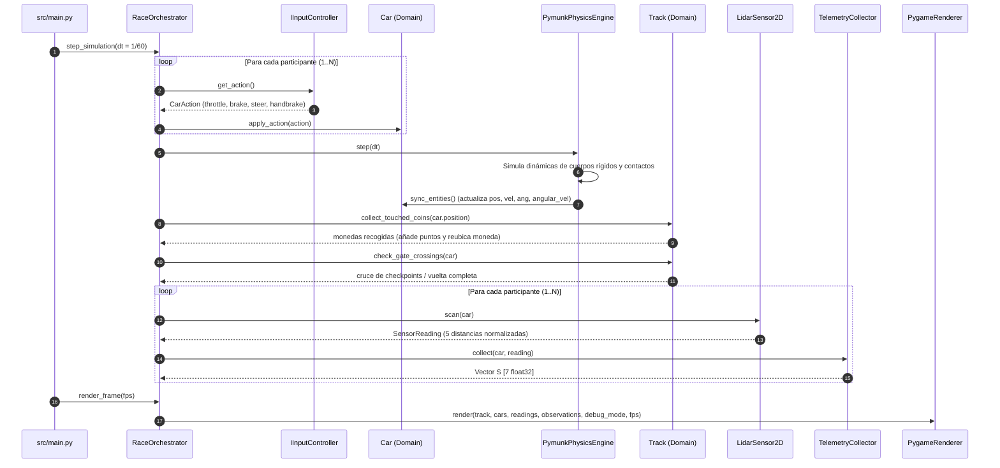

# Arquitectura Integral del Sistema (Software Architecture Document)

Este documento describe la arquitectura global del **Simulador de Carreras 2D con Telemetría LIDAR y Aprendizaje por Refuerzo**, cubriendo sus principios de diseño, organización por capas (DDD / Clean Architecture), subsistemas de física, sensores, renderizado, telemetría e inteligencia artificial, y flujo de datos.

---

## 1. Visión y Principios de Diseño

El sistema está diseñado para cumplir tres objetivos fundamentales:
1. **Desacoplamiento Estricto (Clean Architecture & DDD):** Las reglas de la lógica vehicular, cálculo de vueltas, detección de sentido y monedas son entidades y casos de uso puros en Python. La capa de dominio no conoce ni importa `pygame` ni `pymunk`.
2. **Modularidad mediante SOLID:** Cualquier componente (el motor de física, el renderizador, el sensor o el controlador de entrada) puede ser sustituido por otra implementación (ej. sustituir `PymunkPhysicsEngine` por Box2D o un motor cinemático propio) implementando la interfaz correspondiente sin alterar la lógica de carrera.
3. **Alto Rendimiento para Entrenamiento RL:** El simulador puede ejecutarse en modo headless sin pantalla a miles de pasos de simulación física por segundo, aprovechando todos los núcleos de CPU del procesador para entrenar redes neuronales con multiprocessing.

```mermaid
flowchart TD
    subgraph CompositionRoot["Raíz de Composición (src/)"]
        MAIN["main.py"]
        TRAIN["train_agent.py"]
    end

    subgraph ApplicationLayer["Capa de Aplicación (src/application/)"]
        ORCH["RaceOrchestrator"]
        TELEM["TelemetryCollector"]
        subgraph RLSubsystem["Subsistema RL (src/application/rl/)"]
            ENV["CarRacingRLEnv (Gymnasium-like)"]
            RC["RewardCalculator"]
            RCFG["RewardConfig (JSON)"]
            TRAINER["RLTrainer (Multiprocessing CPU)"]
        end
    end

    subgraph DomainLayer["Capa de Dominio (src/domain/)"]
        subgraph Entities["Entidades"]
            CAR["Car & CarConfig"]
            TRACK["Track & TrackGate"]
            COIN["Coin"]
            OBS["Obstacle"]
            SREAD["SensorReading & SensorRay"]
        end
        subgraph ValueObjects["Objetos de Valor"]
            VEC["Vector2D"]
            SPD["Speed"]
            ANG["Angle"]
            COL["Color"]
            ACT["CarAction"]
        end
        subgraph Interfaces["Interfaces / Puertos"]
            IPHYS["IPhysicsEngine"]
            ISENS["ISensor"]
            IREND["IRenderer"]
            IINP["IInputController"]
            ITELEM["ITelemetryProvider"]
            ICONT["IControllable"]
        end
    end

    subgraph InfrastructureLayer["Capa de Infraestructura (src/infrastructure/)"]
        subgraph PhysicsAdapter["Física"]
            PE["PymunkPhysicsEngine"]
            PB["PymunkCarBody"]
        end
        subgraph SensorAdapter["Sensores"]
            LS["LidarSensor2D (segment_query)"]
        end
        subgraph RenderAdapter["Renderizado"]
            PR["PygameRenderer"]
            SM["SpriteManager"]
        end
        subgraph InputAdapter["Controladores"]
            HK["HumanKeyboardController"]
            RLC["RLAgentController"]
            DAC["DummyAiController"]
        end
        subgraph AIAdapter["Redes Neuronales"]
            MLP["MLPPolicy (7 -> 32 -> 32 -> 2)"]
        end
    end

    %% Relaciones de dependencia e inyección
    MAIN --> ORCH
    MAIN --> PE
    MAIN --> LS
    MAIN --> PR
    MAIN --> HK
    MAIN --> RLC

    TRAIN --> TRAINER
    TRAINER --> ENV
    ENV --> RC
    ENV --> PE
    ENV --> LS
    RC --> RCFG

    ORCH --> CAR
    ORCH --> TRACK
    ORCH --> TELEM
    ORCH --> IPHYS
    ORCH --> ISENS
    ORCH --> IREND
    ORCH --> IINP

    CAR ..|> ICONT
    TELEM ..|> ITELEM

    PE ..|> IPHYS
    LS ..|> ISENS
    PR ..|> IREND
    HK ..|> IINP
    RLC ..|> IINP
    DAC ..|> IINP
    RLC --> MLP
```

---

## 2. Descripción Detallada de las Capas

### 2.1 Capa de Dominio (`src/domain/`)
Es el corazón del proyecto y **no posee ninguna dependencia de frameworks externos** (prohibido importar `pygame` o `pymunk`).

* **Entidades ([`src/domain/entities/`](file:///home/kevin/Documentos/personal/pythonZZZ/simulador%20carritos%20fuuui/src/domain/entities)):**
  * [`Car`](file:///home/kevin/Documentos/personal/pythonZZZ/simulador%20carritos%20fuuui/src/domain/entities/car.py): Entidad vehicular con cinemática, velocidad longitudinal/lateral, ángulo, control de vueltas completadas (`laps_completed`), checkpoints atravesados, monedas recogidas (`coins_collected`), puntuación total (`score`) y estado de colisión.
  * [`Track`](file:///home/kevin/Documentos/personal/pythonZZZ/simulador%20carritos%20fuuui/src/domain/entities/track.py): Representación geométrica del circuito con línea central poligonal interpolada, compuertas direccionales de control ([`TrackGate`](file:///home/kevin/Documentos/personal/pythonZZZ/simulador%20carritos%20fuuui/src/domain/entities/track.py)), zonas de superficie (asfalto, pianos, césped), obstáculos físicos y de terreno, y monedas activas.
  * [`Coin`](file:///home/kevin/Documentos/personal/pythonZZZ/simulador%20carritos%20fuuui/src/domain/entities/coin.py): Moneda coleccionable con identificador, posición, radio de interacción y valor en puntos.
  * [`Obstacle`](file:///home/kevin/Documentos/personal/pythonZZZ/simulador%20carritos%20fuuui/src/domain/entities/obstacle.py): Obstáculos que pueden ser sólidos y dinámicos (conos de tráfico que rebotan con impulso físico, barreras rígidas de hormigón) o de terreno (baches gigantes que frenan y manchas de aceite que provocan pérdida de tracción).
  * [`SensorReading`](file:///home/kevin/Documentos/personal/pythonZZZ/simulador%20carritos%20fuuui/src/domain/entities/sensor_reading.py) y [`SensorRay`](file:///home/kevin/Documentos/personal/pythonZZZ/simulador%20carritos%20fuuui/src/domain/entities/sensor_reading.py): Paquetes inmutables de telemetría sensorial con 5 rayos equidistantes ($0^\circ, +45^\circ, -45^\circ, +90^\circ, -90^\circ$).

* **Objetos de Valor ([`src/domain/value_objects/`](file:///home/kevin/Documentos/personal/pythonZZZ/simulador%20carritos%20fuuui/src/domain/value_objects)):**
  * [`Vector2D`](file:///home/kevin/Documentos/personal/pythonZZZ/simulador%20carritos%20fuuui/src/domain/value_objects/vector2d.py): Aritmética vectorial 2D inmutable (suma, resta, producto escalar `dot`, producto vectorial cruzado `cross`, rotación, magnitud y normalización).
  * [`Angle`](file:///home/kevin/Documentos/personal/pythonZZZ/simulador%20carritos%20fuuui/src/domain/value_objects/angle.py): Representación angular normalizada en $[-\pi, \pi]$ con transformaciones a vectores unitarios frontales y laterales.
  * [`Speed`](file:///home/kevin/Documentos/personal/pythonZZZ/simulador%20carritos%20fuuui/src/domain/value_objects/speed.py): Magnitud de velocidad con límites de aceleración frontal y marcha atrás.
  * [`Color`](file:///home/kevin/Documentos/personal/pythonZZZ/simulador%20carritos%20fuuui/src/domain/value_objects/color.py): Paleta de colores RGB y conversiones a string hexadecimal.
  * [`CarAction`](file:///home/kevin/Documentos/personal/pythonZZZ/simulador%20carritos%20fuuui/src/domain/value_objects/car_action.py): Vector de control del conductor (`throttle`, `brake`, `steer`, `handbrake`).

* **Interfaces / Puertos ([`src/domain/interfaces/`](file:///home/kevin/Documentos/personal/pythonZZZ/simulador%20carritos%20fuuui/src/domain/interfaces)):**
  * [`IPhysicsEngine`](file:///home/kevin/Documentos/personal/pythonZZZ/simulador%20carritos%20fuuui/src/domain/interfaces/physics_engine.py): Contrato de simulación física paso a paso.
  * [`ISensor`](file:///home/kevin/Documentos/personal/pythonZZZ/simulador%20carritos%20fuuui/src/domain/interfaces/sensor.py): Contrato para escanear el entorno espacial.
  * [`IRenderer`](file:///home/kevin/Documentos/personal/pythonZZZ/simulador%20carritos%20fuuui/src/domain/interfaces/renderer.py): Contrato de renderizado visual.
  * [`IInputController`](file:///home/kevin/Documentos/personal/pythonZZZ/simulador%20carritos%20fuuui/src/domain/interfaces/input_controller.py): Contrato para proveedores de acción (humanos, heurísticos o redes neuronales).
  * [`ITelemetryProvider`](file:///home/kevin/Documentos/personal/pythonZZZ/simulador%20carritos%20fuuui/src/domain/interfaces/telemetry_provider.py): Contrato de sólo lectura de estado vectorial.
  * [`IControllable`](file:///home/kevin/Documentos/personal/pythonZZZ/simulador%20carritos%20fuuui/src/domain/interfaces/controllable.py): Contrato para aplicar comandos de conducción.

---

### 2.2 Capa de Aplicación (`src/application/`)
Coordina los casos de uso principales:

1. **[`RaceOrchestrator`](file:///home/kevin/Documentos/personal/pythonZZZ/simulador%20carritos%20fuuui/src/application/race_orchestrator.py):**
   * Gestiona el bucle de carrera a 60 FPS fijos (`FIXED_DT = 1/60`).
   * Soporta múltiples participantes simultáneos (`num_cars`) organizados en una parrilla de salida escalonada (`compute_grid_spawn_position`).
   * Valida en cada paso el cruce de las compuertas de la pista ([`TrackGate`](file:///home/kevin/Documentos/personal/pythonZZZ/simulador%20carritos%20fuuui/src/domain/entities/track.py)):
     - Checkpoints obligatorios en orden $1 \to 2 \to 3$.
     - Paso de meta (gate 0) que solo otorga vuelta y punto si se recorrieron todos los checkpoints previos y en el sentido correcto (imposibilita dar media vuelta para sumar vueltas en reversa).
   * Detecta y procesa la recolección de monedas ([`Track.collect_touched_coins`](file:///home/kevin/Documentos/personal/pythonZZZ/simulador%20carritos%20fuuui/src/domain/entities/track.py)), reubicándolas de inmediato en nuevos puntos de asfalto alcanzable.
   * Coordina el cambio de mapa en caliente sin reiniciar el proceso.

2. **[`TelemetryCollector`](file:///home/kevin/Documentos/personal/pythonZZZ/simulador%20carritos%20fuuui/src/application/telemetry_collector.py):**
   * Convierte lecturas crudas en el vector normalizado de estado $S \in \mathbb{R}^7$:
     $$S = \left[ \frac{d_0}{R_{\max}}, \frac{d_{45^\circ}}{R_{\max}}, \frac{d_{-45^\circ}}{R_{\max}}, \frac{d_{90^\circ}}{R_{\max}}, \frac{d_{-90^\circ}}{R_{\max}}, \frac{v}{v_{\max}}, \frac{\omega}{\omega_{\max}} \right]$$

3. **Subsistema de Aprendizaje por Refuerzo (`src/application/rl/`):**
   * [`RewardConfig`](file:///home/kevin/Documentos/personal/pythonZZZ/simulador%20carritos%20fuuui/src/application/rl/reward_config.py): Carga pesos desde [`config/reward_config.json`](file:///home/kevin/Documentos/personal/pythonZZZ/simulador%20carritos%20fuuui/config/reward_config.json).
   * [`RewardCalculator`](file:///home/kevin/Documentos/personal/pythonZZZ/simulador%20carritos%20fuuui/src/application/rl/reward_config.py): Calcula en cada paso recompensas compuestas (avance en sentido de pista, alineación en curvas, bonificación por asfalto, premio por monedas recogidas, checkpoints y vueltas, castigos por baches, aceite, conos, barreras y muros, y penalización progresiva por atasco contra paredes).
   * [`CarRacingRLEnv`](file:///home/kevin/Documentos/personal/pythonZZZ/simulador%20carritos%20fuuui/src/application/rl/car_racing_env.py): Entorno compatible con el estándar Gymnasium (`reset()`, `step()`) para ejecución headless de alta velocidad.
   * [`RLTrainer`](file:///home/kevin/Documentos/personal/pythonZZZ/simulador%20carritos%20fuuui/src/application/rl/trainer.py): Optimizador genético / CEM-NES (*Natural Evolution Strategies*) que distribuye la evaluación de la población en paralelo mediante `multiprocessing` en todos los núcleos de CPU.

---

### 2.3 Capa de Infraestructura (`src/infrastructure/`)
Implementa las interfaces definidas en el dominio utilizando bibliotecas de terceros:

1. **Física (`src/infrastructure/physics/`):**
   * [`PymunkPhysicsEngine`](file:///home/kevin/Documentos/personal/pythonZZZ/simulador%20carritos%20fuuui/src/infrastructure/physics/pymunk_physics_engine.py): Espacio de Chipmunk 2D optimizado con árbol espacial (*Spatial Hash*), gestión de colisiones y fricciones.
   * [`PymunkCarBody`](file:///home/kevin/Documentos/personal/pythonZZZ/simulador%20carritos%20fuuui/src/infrastructure/physics/pymunk_car_body.py): Cuerpo rígido con ruedas virtuales que calcula fricción lateral desacoplada para lograr conducción arcade asistida, respuesta de volante inmediata y maniobra de reversa natural.
   * **Obstáculos:** Conos modelados como círculos dinámicos ligeros con rebote elástico; barreras rígidas estáticas; baches y aceite modelados como sensores espaciales de paso sin tope rígido pero con impacto en adherencia.

2. **Sensores LIDAR (`src/infrastructure/sensors/`):**
   * [`LidarSensor2D`](file:///home/kevin/Documentos/personal/pythonZZZ/simulador%20carritos%20fuuui/src/infrastructure/sensors/lidar_sensor_2d.py): Utiliza `segment_query_first` de Pymunk sobre una máscara de colisiones que detecta muros, barreras, conos y sensores de obstáculos de terreno, ignorando la forma del propio vehículo.

3. **Renderizado (`src/infrastructure/rendering/`):**
   * [`PygameRenderer`](file:///home/kevin/Documentos/personal/pythonZZZ/simulador%20carritos%20fuuui/src/infrastructure/rendering/pygame_renderer.py):
     - Cámara cenital con interpolación suave (`lerp`) y límites (*clamping*) dentro de las dimensiones del circuito.
     - Dibujado de pista poligonal de alta resolución (asfalto, pianos bicolores, muros exteriores e interiores).
     - Renderizado de monedas doradas brillantes con pulso visual tanto en pista como en minimapa.
     - Minimapa vectorial interactivo con escala automática y proyección de todos los vehículos y monedas.
     - Panel de estado multi-coche en la esquina inferior derecha (`#`, Vuelta, Checkpoints, Monedas y Puntos totales).
     - Modo de depuración visual (`F3`) con rayos LIDAR y vector $S$.
   * [`SpriteManager`](file:///home/kevin/Documentos/personal/pythonZZZ/simulador%20carritos%20fuuui/src/infrastructure/rendering/sprite_manager.py): Carga y tintado dinámico de sprites de vehículos según la paleta [`Color`](file:///home/kevin/Documentos/personal/pythonZZZ/simulador%20carritos%20fuuui/src/domain/value_objects/color.py).

4. **Controladores de Entrada (`src/infrastructure/input/`):**
   * [`HumanKeyboardController`](file:///home/kevin/Documentos/personal/pythonZZZ/simulador%20carritos%20fuuui/src/infrastructure/input/human_keyboard_controller.py): Lee teclado (WASD, Flechas, Espacio).
   * [`RLAgentController`](file:///home/kevin/Documentos/personal/pythonZZZ/simulador%20carritos%20fuuui/src/infrastructure/input/rl_agent_controller.py): Conecta la telemetría del coche a la red neuronal cargada desde disco (`.npz`).
   * [`DummyAiController`](file:///home/kevin/Documentos/personal/pythonZZZ/simulador%20carritos%20fuuui/src/infrastructure/input/dummy_ai_controller.py): Controlador heurístico de pruebas.

5. **Red Neuronal e Inferencia (`src/infrastructure/ai/`):**
   * [`MLPPolicy`](file:///home/kevin/Documentos/personal/pythonZZZ/simulador%20carritos%20fuuui/src/infrastructure/ai/mlp_policy.py): Red Neuronal Perceptrón Multicapa con arquitectura $7 \to 32 \to 32 \to 2$ y activación $\tanh$. Incluye máquina de estados de seguridad para maniobras de reversa y desatasco ante obstáculos frontales cerrados.

---

## 3. Flujo de Ejecución de un Fotograma (Runtime Sequence)



---

## 4. Estructura de Directorios y Correspondencia Arquitectónica

```text
├── assets/
│   ├── maps/                     # 12 Circuitos en formato JSON estructurado
│   └── sprites/                  # Sprites generados en PNG para la paleta de vehículos
├── config/
│   └── reward_config.json        # Configuración declarativa de recompensas y castigos RL
├── docs/
│   ├── architecture.md           # [Este documento] Arquitectura global e integral
│   ├── system_design.md          # Especificación de interfaces, contratos SOLID y diagramas
│   ├── physics_model.md          # Modelo físico arcade asistido, ruedas virtuales y fricción
│   ├── rendering_and_maps.md     # Cámara de seguimiento, renderizado por capas y catálogo de circuitos
│   ├── lidar_spec.md             # Especificación matemática del sensor LIDAR y vector S
│   └── rl_training_guide.md      # Guía de entrenamiento de redes neuronales en CPU local
├── models/
│   ├── rl_agent_v1.npz           # Pesos serializados del Perceptrón Multicapa (MLP)
│   └── training_history.json     # Histórico de rendimiento (fitness medio y máximo por generación)
├── src/
│   ├── application/              # Orquestación de casos de uso y entorno de RL
│   │   ├── race_orchestrator.py  # Bucle multi-vehículo, parrilla, vueltas y recolección
│   │   ├── telemetry_collector.py # Generación del vector S normalizado
│   │   └── rl/                   # Gimnasio RL, recompensas y entrenador evolutivo CPU
│   ├── domain/                   # Entidades, objetos de valor e interfaces puras (DDD)
│   │   ├── entities/             # Car, Track, Coin, Obstacle, SensorReading
│   │   ├── interfaces/           # IPhysicsEngine, ISensor, IRenderer, IInputController, etc.
│   │   └── value_objects/        # Vector2D, Speed, Angle, Color, CarAction
│   ├── infrastructure/           # Implementaciones con Pymunk, Pygame-CE y NumPy
│   │   ├── ai/                   # MLPPolicy e inferencia neuronal
│   │   ├── input/                # Controladores de teclado, IA y dummy
│   │   ├── physics/              # Adaptador de Chipmunk 2D y cuerpos rígidos
│   │   ├── rendering/            # Renderizador gráfico, cámara, minimapa y HUD
│   │   └── sensors/              # Emisor de rayos LIDAR por consultas espaciales
│   ├── train_agent.py            # CLI para entrenamiento genético / CEM-NES multinúcleo
│   └── main.py                   # Raíz de composición (DIP) y punto de entrada del juego
├── tests/
│   ├── test_domain_car.py        # Verificación de lógica de dominio, cinemática y pureza DIP
│   ├── test_lidar_calculations.py # Verificación geométrica de rayos y normalización S
│   └── test_rl_training.py       # Verificación del entorno RL, monedas, atasco y multi-coche
├── pyproject.toml
├── requirements.txt
└── README.md
```

---

## 5. Extensibilidad y Nuevas Funcionalidades

* **Añadir un nuevo tipo de controlador (ej. modelo PPO / SAC / Red Recurrente LSTM):**
  Solo es necesario implementar la interfaz [`IInputController`](file:///home/kevin/Documentos/personal/pythonZZZ/simulador%20carritos%20fuuui/src/domain/interfaces/input_controller.py) y recibir `ITelemetryProvider`.
* **Añadir nuevos circuitos:**
  Crear un archivo `.json` en `assets/maps/` siguiendo el esquema documentado en [`docs/rendering_and_maps.md`](file:///home/kevin/Documentos/personal/pythonZZZ/simulador%20carritos%20fuuui/docs/rendering_and_maps.md).
* **Modificar las recompensas de la IA:**
  Editar los valores numéricos en [`config/reward_config.json`](file:///home/kevin/Documentos/personal/pythonZZZ/simulador%20carritos%20fuuui/config/reward_config.json) sin compilar ni modificar código fuente.
