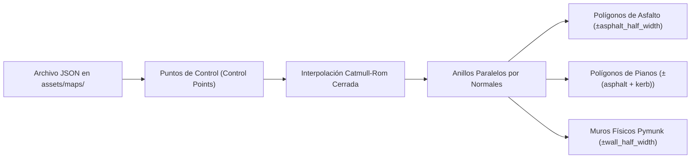

# Guía Técnica: Sistema de Renderizado 2D, Cámara y Creación de Mapas

## 1. Creación y Generación Procedural de Mapas (`Track`)

Los circuitos del simulador se definen mediante curvas paramétricas cerradas en [`Track`](file:///home/kevin/Documentos/personal/pythonZZZ/simulador%20carritos%20fuuui/src/domain/entities/track.py) y archivos JSON ubicados en `assets/maps/`. Esto permite crear pistas gigantescas (de $3200 \times 2200\text{ px}$ o más) con curvas suaves a partir de unos pocos puntos de control.



### 1.1 Interpolación de la Línea Central (Catmull-Rom)
A partir de una lista ordenada de $N$ puntos de control $\vec{P}_0, \vec{P}_1, \dots, \vec{P}_{N-1}$ que forman un bucle cerrado, la función `_catmull_rom_closed_spline` subdivide cada tramo en `subdivisions_per_segment` (por defecto 12) utilizando la formulación matricial de **Catmull-Rom**:

$$\vec{C}(t) = \frac{1}{2} \left[ (2\vec{P}_1) + (-\vec{P}_0 + \vec{P}_2)t + (2\vec{P}_0 - 5\vec{P}_1 + 4\vec{P}_2 - \vec{P}_3)t^2 + (-\vec{P}_0 + 3\vec{P}_1 - 3\vec{P}_2 + \vec{P}_3)t^3 \right]$$

Esto garantiza continuidad $C^1$ (tangentes suaves sin esquinas bruscas) y que la pista pase exactamente por todos los puntos de control diseñados.

### 1.2 Generación de Anillos de Superficie y Barreras (`_compute_offset_rings`)
Para cada vértice $\vec{C}_i$ de la línea central suavizada:
1. Se calcula el vector tangente unitario:
   $$\hat{t}_i = \frac{\vec{C}_{i+1} - \vec{C}_{i-1}}{\|\vec{C}_{i+1} - \vec{C}_{i-1}\|}$$
2. Se obtiene la normal perpendicular unitaria $\hat{n}_i = (-t_{i,y}, t_{i,x})$.
3. Se proyectan tres pares de anillos concéntricos (exterior e interior) desplazados una distancia $d$ sobre la normal $\vec{C}_i \pm d \cdot \hat{n}_i$:
   - **Anillo de Asfalto** ($d = \text{asphalt\_half\_width}$, ej. $115\text{ px}$, dando un ancho total de calzada de $230\text{ px}$).
   - **Anillo de Pianos / Bordes** ($d = \text{asphalt\_half\_width} + \text{kerb\_width}$, ej. $133\text{ px}$).
   - **Anillo de Muros Físicos** ($d = \text{wall\_half\_width}$, ej. $165\text{ px}$), convertido en segmentos `TrackSegment` registrados como `pymunk.Segment` estáticos en Pymunk.
   - El espacio comprendido entre el piano y el muro constituye la escapatoria de **Césped (`grass`)**.

### 1.3 Catálogo de Mapas Incluidos (`assets/maps/`)
| Clave (`--map`) | Tecla Rápida | Nombre | Dimensiones del Mundo | Estilo |
| :--- | :---: | :--- | :---: | :--- |
| `retro_grand_prix` | `1` | **Retro Grand Prix** | $3200 \times 2200\text{ px}$ | Clásico amplio con rectas largas y chicane suave |
| `neon_speedway` | `2` | **Super Oval & Chicane Speedway** | $3400 \times 2200\text{ px}$ | Anillo de máxima velocidad con calzada extra ancha ($260\text{ px}$) |
| `canyon_drift` | `3` | **Canyon Drift Circuit** | $3400 \times 2400\text{ px}$ | Curvas enlazadas en "S" ideal para derrapar con `Espacio` |
| `starlight_loop` | `4` | **Starlight Grand Loop** | $3200 \times 2400\text{ px}$ | Circuito en forma de trébol con rectas diagonales rápidas |

### 1.4 Cómo Crear un Nuevo Mapa Personalizado (JSON)
Cualquier archivo `.json` en `assets/maps/` sigue esta estructura:
```json
{
  "name": "Mi Circuito Personalizado",
  "description": "Descripción breve del trazado.",
  "width": 3400.0,
  "height": 2400.0,
  "asphalt_half_width": 120.0,
  "kerb_width": 18.0,
  "wall_half_width": 175.0,
  "subdivisions_per_segment": 12,
  "start_index": 12,
  "control_points": [
    [900.0, 1800.0],
    [2400.0, 1800.0],
    [2800.0, 1100.0],
    [2400.0, 450.0],
    [900.0, 450.0],
    [450.0, 1100.0]
  ]
}
```
**Reglas prácticas de diseño:**
1. Deja al menos `wall_half_width + 150 px` de margen entre cualquier punto de control y los bordes del mundo (`0` a `width`, `0` a `height`).
2. Ordena los `control_points` siguiendo el sentido de giro deseado de la pista.
3. Para cargarlo en código basta con invocar `Track.from_json_file("assets/maps/mi_mapa.json")`.

---

## 2. Arquitectura del Motor de Renderizado (`PygameRenderer`)

El renderizador ([`PygameRenderer`](file:///home/kevin/Documentos/personal/pythonZZZ/simulador%20carritos%20fuuui/src/infrastructure/rendering/pygame_renderer.py)) está diseñado para mantener **60 FPS constantes** incluso en mapas enormes de $3400 \times 2400\text{ px}$.

### 2.1 Caché de Superficie del Mundo Estático (`_build_track_surface`)
Dibujar cientos de polígonos de asfalto, pianos y muros en cada frame sería costoso. En su lugar, cuando se carga o cambia un mapa:
1. Se crea una única `pygame.Surface` del tamaño completo del mundo (`width x height`).
2. Se pintan en orden de profundidad (algoritmo del pintor):
   - Fondo de césped con bandas horizontales estilo 16-bits.
   - Polígono de escapatoria interior/exterior.
   - Cuadriláteros alternados rojos y blancos para los **pianos/bordes**.
   - Cuadriláteros gris oscuro para el **asfalto**, bordes blancos continuos y línea central discontinua.
   - Línea de meta ajedrezada en `start_index`.
   - Segmentos de barrera física exterior e interior.
3. Esta superficie queda guardada en `self._track_surface_cache` y se genera también una versión reducida (`230 x 155 px`) en `self._minimap_surface_cache`.

### 2.2 Cámara de Seguimiento Suave y Transformación Mundo $\to$ Pantalla
La ventana de visualización (*viewport*) mide `1280 x 800 px`. En cada fotograma:
1. La cámara calcula la posición deseada centrando al vehículo principal:
   $$\vec{C}_{\text{deseada}} = \vec{P}_{\text{coche}} - \left(\frac{W_{\text{viewport}}}{2}, \frac{H_{\text{viewport}}}{2}\right)$$
2. Se acota dentro de los límites del mundo $[0, W_{\text{mundo}} - W_{\text{viewport}}]$ y se interpola suavemente (`lerp = 0.25`) para lograr un desplazamiento fluido:
   $$\vec{C}_{t} = \vec{C}_{t-1} + 0.25 \, (\vec{C}_{\text{clamped}} - \vec{C}_{t-1})$$
3. Solo se copia a pantalla el rectángulo visible mediante `screen.blit(_track_surface_cache, (0, 0), area=cam_rect)` con coste $O(1)$.
4. Todo elemento dinámico (sprites de coches, rayos LIDAR y puntos de colisión) convierte sus coordenadas globales del mundo $(x_w, y_w)$ a coordenadas de ventana $(x_s, y_s)$ con `world_to_screen`:
   $$(x_s, y_s) = (x_w - C_x, \; y_w - C_y)$$

### 2.3 Generación y Rotación de Sprites (`SpriteManager`)
- [`SpriteManager`](file:///home/kevin/Documentos/personal/pythonZZZ/simulador%20carritos%20fuuui/src/infrastructure/rendering/sprite_manager.py) construye proceduralmente el sprite del vehículo con neumáticos, carrocería sombreada según el objeto de valor `Color`, franja deportiva, parabrisas, faros delanteros y luces de freno.
- En cada frame se rota el sprite base con `pygame.transform.rotate(base_sprite, -degrees(car.angle.radians))` centrado exactamente en `world_to_screen(car.position)`.

### 2.4 Minimapa, Overlay LIDAR y HUD (`F3`)
- **Minimapa (esquina superior derecha):** Muestra el circuito completo a escala, un recuadro blanco que representa la ventana actual de la cámara, el marcador del siguiente checkpoint activo y puntos coloreados con la posición en vivo de cada coche.
- **Overlay LIDAR (`F3`):** Dibuja desde el frente del chasis los 5 rayos en verde (`hit=False`) o rojo con círculo de impacto amarillo/rojo (`hit=True`), además del panel HUD con el vector normalizado $S \in \mathbb{R}^7$.

---

## 3. Sistema de Contador de Puntos y Validación de Vuelta Completa (`TrackGate`)

Para garantizar que cada punto (`+1`) corresponda genuinamente a una **vuelta completa en el sentido correcto** y evitar trampas (como retroceder sobre la meta o dar media vuelta a mitad de pista):

1. **4 Puertas Transversales (`TrackGate`):**
   - `Gate 0`: Línea de Salida / Meta (en `start_index`).
   - `Gate 1`, `Gate 2`, `Gate 3`: Tres checkpoints intermedios distribuidos al $25\%$, $50\%$ y $75\%$ del circuito, con un vector normal $\hat{n}_{\text{fwd}}$ apuntando en el sentido válido de carrera.
2. **Detección Geométrica y de Sentido (`check_gate_crossings`):**
   - En cada paso $\Delta t$, se comprueba la intersección entre el vector desplazamiento del coche $[\vec{P}_{t-1}, \vec{P}_t]$ y el segmento transversal de cada puerta $[\vec{G}_{\text{outer}}, \vec{G}_{\text{inner}}]$.
   - El signo del producto escalar $(\vec{P}_t - \vec{P}_{t-1}) \cdot \hat{n}_{\text{fwd}}$ determina si el cruce fue en el **sentido válido (`is_forward = True`)** o **en sentido contrario (`is_forward = False`)**.
3. **Máquina de Estados Anti-Trampas (`Car.record_gate_crossing`):**
   - El coche inicia con `next_checkpoint_id = 1` y `checkpoints_passed_in_lap = 0`.
   - Solo avanza su estado cuando cruza el checkpoint esperado (`1 -> 2 -> 3`) con `is_forward == True`.
   - Si el jugador da media vuelta y cruza hacia atrás (`is_forward == False`) el último checkpoint superado, **se descuenta ese checkpoint** (`checkpoints_passed_in_lap -= 1`).
   - Al cruzar la Línea de Meta (`Gate 0`), **únicamente se suma `+1` punto** si `checkpoints_passed_in_lap == 3` y `is_forward == True`.
   - Además, si el coche circula en dirección opuesta a la tangente de la pista, el HUD muestra un aviso inmediato: **`¡SENTIDO CONTRARIO! DA LA VUELTA`**.
