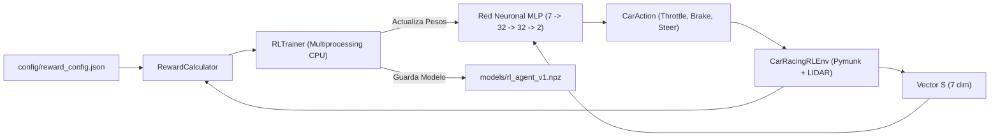

# Guía de Entrenamiento por Refuerzo (RL) y Configuración de Recompensas

## 1. Visión General del Sistema de Entrenamiento (Versión 1)

El simulador incorpora un sistema completo de **Aprendizaje por Refuerzo (*Reinforcement Learning*)** desacoplado en tres módulos principales:
1. **Configuración y Calculadora de Recompensas ([`RewardConfig` / `RewardCalculator`](../src/application/rl/reward_config.py)):** Parametrizable mediante el archivo externo [`config/reward_config.json`](../config/reward_config.json) sin necesidad de tocar el código fuente.
2. **Entorno de Simulación RL ([`CarRacingRLEnv`](../src/application/rl/car_racing_env.py)):** Sigue el estándar de `Gymnasium` (`reset()`, `step(action)`, `render()`, `close()`), ejecutándose sin interfaz gráfica a miles de pasos por segundo.
3. **Red Neuronal MLP y Entrenador Multinúcleo ([`MLPPolicy`](../src/infrastructure/ai/mlp_policy.py) y [`RLTrainer`](../src/application/rl/trainer.py)):** Perceptrón Multicapa ($7 \to 32 \to 32 \to 2$) entrenado en paralelo en todos los núcleos del procesador mediante Estrategias Evolutivas y Método de Entropía Cruzada (*CEM-NES*).



---

## 2. Arquitectura de la Red Neuronal (`MLPPolicy`)

- **Capa de Entrada ($7$ neuronas):** Recibe el vector de observación normalizado $S$:
  $$S = \left[ \frac{d_0}{R_{\max}}, \frac{d_{45^\circ}}{R_{\max}}, \frac{d_{-45^\circ}}{R_{\max}}, \frac{d_{90^\circ}}{R_{\max}}, \frac{d_{-90^\circ}}{R_{\max}}, \frac{v}{v_{\max}}, \frac{\omega}{\omega_{\max}} \right]$$
  > [!IMPORTANT]
  > Tanto los obstáculos sólidos (**muros, conos y barreras**) como los peligros de terreno (**baches gigantes y manchas de aceite**, registrados como sensores espaciales en Pymunk) son detectados por los 5 rayos `segment_query` del LIDAR. Esto permite que la red neuronal "vea" un bache o charco de aceite a distancia y gire para esquivarlo antes de pisarlo.
- **Capas Ocultas ($32 \times 32$ neuronas con activación $\tanh$):** Procesan la geometría de las curvas y la asimetría entre rayos izquierdos y derechos para decidir cuándo frenar antes de una horquilla y hacia qué lado esquivar un obstáculo.
- **Capa de Salida ($2$ neuronas en $[-1.0, 1.0]$):**
  - `out[0]`: Acelerador (si $>0$) o Freno/Reversa (si $<0$).
  - `out[1]`: Giro del volante (`steer` $\in [-1.0, 1.0]$).

---

## 3. Cómo Ajustar las Recompensas y Penalizaciones (`config/reward_config.json`)

Todos los premios y castigos se leen desde [`config/reward_config.json`](../config/reward_config.json). Puedes editar cualquier número con un editor de texto y volver a lanzar `src/train_agent.py`:

| Parámetro en `reward_config.json` | Valor por Defecto | Qué hace exactamente |
| :--- | :---: | :--- |
| `forward_progress_weight` | `+1.6` | Premia avanzar a buena velocidad proyectada sobre el sentido de la pista. |
| `curve_alignment_weight` | `+0.7` | Premia mantener el chasis alineado con la tangente de cada curva. |
| `asphalt_center_bonus` | `+0.35` | Bonificación por mantenerse dentro del asfalto limpio. |
| `obstacle_clearance_bonus` | `+0.45` | Premia mantener despejados los rayos frontales/diagonales (esquivar obstáculos con margen). |
| `checkpoint_reward` | **`+65.0`** | **Premio grande al cruzar cada Checkpoint (`1 -> 2 -> 3`) en el sentido correcto.** |
| `lap_completion_reward` | **`+250.0`** | **Gran premio al completar una vuelta entera válida (cruzar Meta tras los 3 checkpoints).** |
| `coin_collected_reward` | **`+180.0`** | **Premio masivo por recolectar cada moneda dorada sobre el asfalto (incentiva activamente salir de la trazada central para cazarla).** |
| `coin_proximity_weight` | **`+2.5`** | **Atracción continua hacia monedas activas visibles por delante del vehículo para crear un gradiente de aprendizaje.** |
| `cone_collision_penalty` | **`-40.0`** | **Quita puntos al chocar contra un cono de tráfico.** |
| `barrier_collision_penalty` | **`-75.0`** | **Quita puntos al estrellarse contra una barrera rígida.** |
| `wall_collision_penalty` | **`-65.0`** | **Quita puntos al impacto inicial contra el muro perimetral de la pista.** |
| `wall_stuck_step_penalty` | **`-14.0`** | **Castigo progresivo por cada frame que el coche se queda pegado/atascado contra un muro haciendo micro-correcciones sin retroceder.** |
| `max_wall_stuck_steps` | `45` | Máximo de pasos continuos atascado contra una pared antes de abortar el episodio. |
| `wall_stuck_timeout_penalty` | **`-160.0`** | **Castigo severo y terminación si no logra desatascarse del muro a tiempo.** |
| `reverse_escape_reward` | **`+4.5`** | **Bonificación por cada paso que el coche retrocede activamente (`v_fwd < -15`) para separarse de un muro frontal y corregir su ángulo.** |
| `pothole_step_penalty` | **`-4.0`** | **Quita puntos en cada frame que el coche pisa un bache gigante.** |
| `oil_slick_step_penalty` | **`-4.5`** | **Quita puntos en cada frame que el coche pisa una mancha de aceite.** |
| `grass_step_penalty` | `-1.5` | Quita puntos por salirse al césped. |
| `wrong_way_step_penalty` | **`-25.0`** | **Castigo severo por cada paso que el coche circula en sentido contrario.** |
| `max_wrong_way_steps` | `90` | Número máximo de pasos seguidos permitidos en sentido contrario ($1.5\text{ s}$). |
| `wrong_way_timeout_penalty` | **`-1000.0`** | **Castigo colosal y fin inmediato del episodio si persiste en sentido contrario.** |
| `reverse_finish_line_penalty` | **`-1500.0`** | **Castigo colosal (anula más de 6 vueltas completas) y terminación inmediata si cruza la línea de meta en sentido contrario.** |
| `reverse_checkpoint_penalty` | **`-400.0`** | **Castigo severo si cruza un checkpoint en sentido contrario.** |
| `terminate_on_wall_crash` | `false` | Se mantiene en `false` para obligar a la IA a aprender a dar marcha atrás y corregir trayectoria tras tocar una pared en curvas cerradas (como en el Mapa 3 `pocket_chicane`). |
| `terminate_on_barrier_crash` | `true` | Si es `true`, el episodio termina al chocar contra una barrera de hormigón. |
| `terminate_on_reverse_finish_line` | `true` | Si es `true`, el episodio termina si cruza la meta al revés. |

> [!NOTE]
> Para comprender en profundidad los fundamentos teóricos, la psicología de diseño de recompensas y la prevención de atajos matemáticos (*reward hacking*), consulta el documento **[`docs/training_philosophy.md`](training_philosophy.md)**.

---

## 4. Comandos para Entrenar y Probar la IA en tu Máquina

### Paso 1: Ejecutar el entrenamiento en tu PC (incluyendo el Mapa 3 `pocket_chicane`)
```bash
# Reentrenamiento con monedas, penalización de atasco en pared y maniobra de reversa
.venv/bin/python3 src/train_agent.py --maps kart_classic pocket_chicane oval_arena --generations 12 --population 16 --max-steps 700 --workers 8
```

### Paso 2: Ver a varios coches IA competir y recolectar monedas (`--num-cars`)
```bash
.venv/bin/python3 src/main.py --controller rl_ai --map pocket_chicane --num-cars 4
```
*(En la esquina inferior derecha verás el panel en vivo con **Vuelta**, **Checkpoints**, **Monedas** y **Puntos totales** de cada coche).*

### Paso 3: Competir Tú (Humano) contra varios coches IA
```bash
.venv/bin/python3 src/main.py --controller human --num-cars 4 --map pocket_chicane
```
