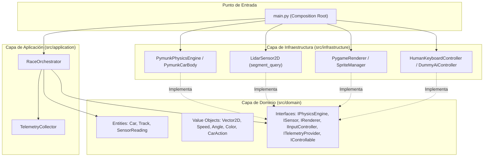
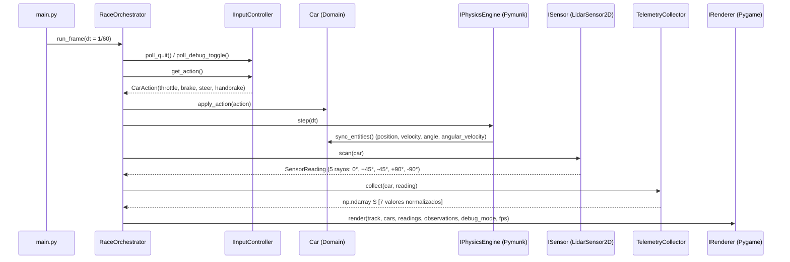

# Diseño del Sistema y Arquitectura Orientada al Dominio (DDD)

## 1. Visión Arquitectónica

El simulador de carreras 2D con telemetría LIDAR está estructurado bajo los principios de **Domain-Driven Design (DDD)**, **Clean Architecture** y **SOLID**. El objetivo primordial es aislar las reglas de negocio vehiculares, cinemáticas y sensoriales (capa de Dominio y Aplicación) de las tecnologías de infraestructura (`pygame-ce` para renderizado/eventos y `pymunk` para motor de física y raycasting 2D).



---

## 2. Diagrama de Clases (Mermaid)

```mermaid
classDiagram
    direction TB

    class Vector2D {
        +float x
        +float y
        +magnitude() float
        +normalized() Vector2D
        +dot(Vector2D other) float
        +rotate(float radians) Vector2D
    }

    class Speed {
        +float value
        +float max_forward
        +float max_reverse
        +normalized() float
    }

    class Angle {
        +float radians
        +degrees() float
        +to_unit_vector() Vector2D
    }

    class Color {
        +int r
        +int g
        +int b
        +str hex_code
        +to_rgb_tuple() tuple
    }

    class CarAction {
        +float throttle
        +float brake
        +float steer
        +bool handbrake
    }

    class Car {
        +str car_id
        +Vector2D position
        +Vector2D velocity
        +Angle angle
        +float angular_velocity
        +Color color
        +CarConfig config
        +float current_surface_grip
        +apply_action(CarAction action) None
        +forward_speed() float
        +normalized_forward_speed() float
        +normalized_angular_velocity() float
    }

    class SensorRay {
        +str ray_id
        +float relative_angle_deg
        +Vector2D origin
        +Vector2D end_point
        +float distance
        +float max_range
        +bool hit
        +normalized_distance() float
    }

    class SensorReading {
        +str car_id
        +tuple~SensorRay~ rays
        +float max_range
        +get_normalized_distances() list~float~
    }

    class Track {
        +str name
        +float width
        +float height
        +list~TrackWall~ outer_boundary
        +list~TrackWall~ inner_boundary
        +list~SurfaceZone~ surface_zones
        +Vector2D start_position
        +Angle start_angle
    }

    class IControllable {
        <<interface>>
        +apply_action(CarAction action)* None
    }

    class ITelemetryProvider {
        <<interface>>
        +get_observation(str car_id)* ndarray
        +get_latest_reading(str car_id)* SensorReading
    }

    class IInputController {
        <<interface>>
        +get_action()* CarAction
        +poll_debug_toggle()* bool
        +poll_quit()* bool
    }

    class IPhysicsEngine {
        <<interface>>
        +register_track(Track track)* None
        +register_car(Car car)* None
        +step(float dt)* None
        +sync_entities()* None
    }

    class ISensor {
        <<interface>>
        +scan(Car car)* SensorReading
    }

    class IRenderer {
        <<interface>>
        +render(Track track, list~Car~ cars, dict readings, dict observations, bool debug_mode, float fps)* None
        +close()* None
    }

    Car ..|> IControllable
    TelemetryCollector ..|> ITelemetryProvider
    HumanKeyboardController ..|> IInputController
    DummyAiController ..|> IInputController
    PymunkPhysicsEngine ..|> IPhysicsEngine
    LidarSensor2D ..|> ISensor
    PygameRenderer ..|> IRenderer
```



---

## 3. Contratos de Comunicación e Interfaces (Principios SOLID)

### 3.1 Responsabilidad Única (SRP)
- `Car` (`src/domain/entities/car.py`): Modela exclusivamente el estado cinemático, configuración dinámica (`CarConfig`) y comandos de control recibidos del piloto o IA.
- `Track` (`src/domain/entities/track.py`): Contiene la definición geométrica del circuito (muros exteriores/interiores, zonas de superficie como asfalto, pianos y césped, punto de partida).
- `LidarSensor2D` (`src/infrastructure/sensors/lidar_sensor_2d.py`): Calcula intersecciones espaciales mediante `segment_query_first` de Pymunk sin acoplarse al renderizador.
- `TelemetryCollector` (`src/application/telemetry_collector.py`): Construye y normaliza el vector de estado $S \in \mathbb{R}^7$ (`np.ndarray`) listo para agentes RL.
- `PygameRenderer` (`src/infrastructure/rendering/pygame_renderer.py`): Dibuja el circuito, el vehículo teñido por `Color`, los rayos LIDAR y el HUD de telemetría.

### 3.2 Abierto/Cerrado (OCP) y Sustitución de Liskov (LSP)
- Cualquier controlador (`HumanKeyboardController`, `DummyAiController`, o un futuro `PPOAgentController`) implementa `IInputController.get_action() -> CarAction`.
- El `RaceOrchestrator` invoca `controller.get_action()` sin conocer si las órdenes provienen del teclado físico o de una política neuronal.

### 3.3 Segregación de Interfaces (ISP)
- `IControllable`: Expone únicamente la manipulación de acciones del vehículo (`apply_action`).
- `ITelemetryProvider`: Expone únicamente la consulta de telemetría (`get_observation`, `get_latest_reading`) sin permitir alterar el estado físico del vehículo.

### 3.4 Inversión de Dependencias (DIP)
- Ningún módulo dentro de `src/domain/` ni `src/application/` importa `pygame` ni `pymunk`.
- La inyección de dependencias se realiza en `src/main.py`.

---

## 4. Flujo de Datos del Bucle Principal (60 FPS)



---

## 5. Guía de Instalación y Configuración del Entorno

### Requisitos Previos
- Python 3.11 o superior.

### Paso 1: Crear y activar el entorno virtual
```bash
python3 -m venv .venv
source .venv/bin/activate
```

### Paso 2: Instalar dependencias fijadas
```bash
pip install -r requirements.txt
```

### Paso 3: Ejecutar la batería de pruebas unitarias
```bash
pytest tests/ -v
```

### Paso 4: Ejecutar el simulador
```bash
python src/main.py
```

### Controles en Ejecución
- `W` / `Flecha Arriba`: Acelerar.
- `S` / `Flecha Abajo`: Frenar / Reversa.
- `A` / `Flecha Izquierda`: Girar a la izquierda.
- `D` / `Flecha Derecha`: Girar a la derecha.
- `Espacio`: Freno de mano (incrementa el derrape lateral).
- `F3`: Alternar el modo de depuración visual LIDAR y HUD de telemetría.
- `ESC`: Salir del simulador.
