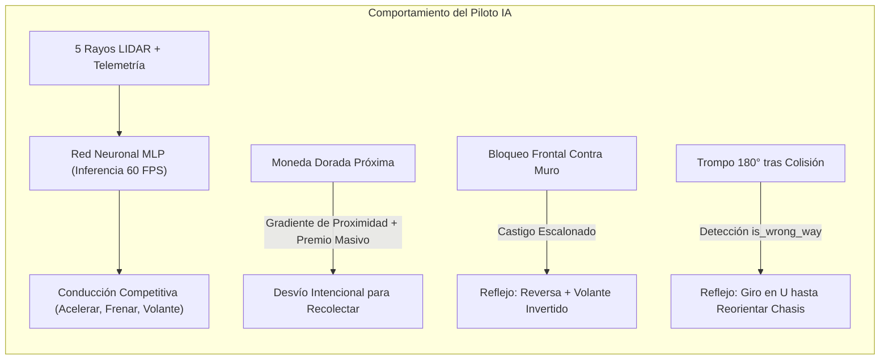
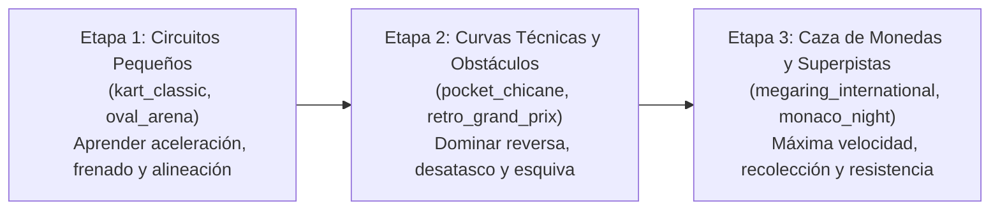

# Filosofía del Entrenamiento por Refuerzo (RL Training Philosophy)

Este documento expone los fundamentos teóricos, la psicología de diseño de recompensas (*Reward Shaping*), los mecanismos anti-trampas (*Anti-Reward Hacking*), la dinámica de recolección de objetivos y la arquitectura de auto-recuperación del sistema de conducción autónoma del simulador.

---

## 1. Visión y Comportamiento Deseado

El objetivo del entrenamiento no es simplemente que una red neuronal "dé vueltas a un circuito", sino forjar un **piloto autónomo competitivo, inteligente y resiliente** con las siguientes capacidades cognitivas y mecánicas:

1. **Trazada Fluida y Anticipación:** Interpretar la asimetría de los 5 rayos sensoriales LIDAR ($0^\circ, \pm 45^\circ, \pm 90^\circ$) para acelerar a fondo en las rectas, frenar antes de horquillas cerradas y anticipar la salida de las curvas.
2. **Búsqueda Activa de Oportunidades (Caza de Monedas):** No limitarse a seguir la línea central de forma autómata, sino desviarse activamente de la trazada ideal para recolectar monedas doradas cuando el riesgo sea asumible.
3. **Esquiva Inteligente de Amenazas:** Discernir entre asfalto limpio y peligros (conos de tráfico elásticos, barreras rígidas, baches que frenan y manchas de aceite resbaladizas).
4. **Auto-Recuperación y Resiliencia Caótica:** En carreras con múltiples rivales (`--num-cars 4+`), los accidentes y empujones son inevitables. El vehículo debe saber cuándo está atascado contra un muro para dar marcha atrás y desatascarse, y cuándo ha sufrido un trompo de $180^\circ$ para dar media vuelta y encarar de nuevo la carrera.

---

## 2. Ingeniería de Recompensas y Prevención de Trampas (Reward Engineering)

El diseño de la función de recompensa escalar $R_t$ es el núcleo del Aprendizaje por Refuerzo. Una red neuronal es implacable: **si existe un atajo matemático para maximizar puntos haciendo trampas o volviéndose cobarde, la red lo encontrará y lo explotará**.

A continuación se detallan las trampas descubiertas durante el desarrollo y cómo la filosofía del entrenamiento las neutraliza:

### 2.1 El Dilema de las Monedas: ¿Por qué la IA las ignoraba al principio?
* **El problema de la complacencia:** Completar una vuelta otorga $+250.0$ puntos y cruzar cada checkpoint $+65.0$. Si recolectar una moneda solo daba $+45.0$ puntos y además requería salirse de la línea central perfecta arriesgando tocar césped o muros, el algoritmo evolutivo aprendía que *lo óptimo era ignorar las monedas por completo*.
* **La solución de dos fases:**
  1. **Premio Masivo por Recolección (`coin_collected_reward = +180.0`):** Recoger una moneda otorga casi tanto valor como una vuelta completa. Ahora la recompensa justifica con creces el desvío.
  2. **Gradiente de Atracción Continuo (`coin_proximity_weight = +2.5`):** Sin una guía intermedia, el espacio de búsqueda es ciego (una moneda a $40\text{ px}$ da 0 puntos hasta que no se toca). El entorno proyecta un cono de atracción: a medida que el coche avanza en sentido correcto y acorta distancia a una moneda visible, recibe una bonificación continua. Esto guía suavemente las mutaciones de la red hacia la moneda.

---

### 2.2 La Trampa de la Meta Inversa: Castigo Colosal (`-1500.0`)
* **El intento de trampa:** En simuladores sin validación estricta, un agente descubre rápidamente que puede cruzar la meta, retroceder $2\text{ metros}$ marcha atrás, volver a cruzar hacia adelante, y repetir esto indefinidamente acumulando puntos de vuelta en pocos segundos sin recorrer el circuito.
* **La defensa por partida doble:**
  1. **Capa de Dominio (Física y Geometría):** La entidad [`Car`](../src/domain/entities/car.py) implementa una máquina de estados obligatoria: la compuerta de meta (gate 0) **sólo otorga puntos si se han cruzado previamente y en orden todos los checkpoints intermedios** ($1 \to 2 \to 3$). Además, cruzar la meta al revés resta inmediatamente puntos al marcador del jugador/coche (`score = max(0, score - 5)`).
  2. **Capa de Refuerzo (Castigo Colosal):** Si el coche atraviesa la línea de meta en sentido contrario, recibe una penalización devastadora:
     $$\text{Penalty}_{\text{reverse\_finish}} = \mathbf{-1500.0}$$
     y el episodio se aborta instantáneamente (`terminated = True`). Un castigo de $-1500.0$ anula el equivalente a más de 6 vueltas perfectas, erradicando cualquier linaje genético que intente aproximarse a la meta desde el lado opuesto.

---

### 2.3 El Problema del Atasco en Paredes: Castigo Escalonado, Reversa Recta y Prevención de Media Vuelta
* **La conducta parásita original:** Al colisionar frontalmente contra un muro en una curva cerrada (ej. Mapa 3 *Pocket Chicane*), la velocidad cae a cero y el coche se quedaba haciendo micro-vibraciones contra la pared sin traccionar.
* **El bug de la "Media Vuelta" (Turnaround Bug):**
  * Si la maniobra de retroceso aplicaba volante lateral mientras retrocedía (`steer = ±1.0`), la física angular de Chipmunk rotaba el chasis $\sim 80^\circ$ marcha atrás. Al volver a avanzar con giro forzado, el coche completaba más de $150^\circ-180^\circ$ de rotación, **terminando encarado en sentido contrario hacia la recta de donde venía**.
  * Al quedar mirando hacia atrás, los rayos LIDAR veían la recta despejada al frente ($d_0 = 1.0$), por lo que la IA pisaba el acelerador a fondo creyendo que avanzaba correctamente.
* **La solución arquitectónica definitiva:**
  1. **Retroceso Corto y Recto (`steer = 0.0` durante 8-9 frames):** La marcha atrás se ejecuta con el volante estrictamente recto. Esto separa el parachoques del muro $\sim 25\text{ px}$ con **cero rotación angular parásita**, preservando intacta la orientación frontal hacia la curva.
  2. **Avance Cauteloso con Bloqueo de Ángulo (`heading_alignment`):** Al reanudar la marcha hacia adelante, el giro está acotado ($\le \pm 0.60$) y se supervisa la alineación con la tangente de la pista. Si el coche se desvía más de $70^\circ$, se neutraliza el volante para evitar que sobrevire hacia atrás.
  3. **Incentivos en la Función de Recompensa:**
     - `wall_stuck_step_penalty = -14.0` (escalado $2.2\times$): castiga permanecer pegado al muro.
     - `reverse_escape_reward = +4.5`: bonifica retroceder en línea recta para despejar el parachoques.

---

## 3. El Desafío Multi-Coche: Trompos de 180° y Simetría del LIDAR

En carreras con varios competidores (`--num-cars 4` o `--vs-ai`), un choque lateral puede provocar un trompo que deje al vehículo **apuntando exactamente hacia atrás**.

### ¿Por qué la red neuronal se confunde al quedar al revés?
Los 5 rayos del sensor LIDAR miden distancias relativas respecto a los muros de la pista. En una recta o un óvalo cerrado, **un corredor mirando hacia adelante tiene los muros a izquierda y derecha a las mismas distancias que si estuviera mirando hacia atrás**. 

El vector de observación normalizado:
$$S = [d_0, d_{45}, d_{-45}, d_{90}, d_{-90}, v, \omega]$$
ve vía despejada al frente ($d_0 \approx 1.0$) en ambas orientaciones. Sin información de la orientación global de la pista, la red interpreta que tiene la pista libre por delante y pisa el acelerador a fondo... **¡avanzando a toda velocidad en dirección contraria!**

### La Solución Arquitectónica: Auto-Recuperación con Giro en U
1. **Detección Rigurosa (`is_wrong_way`):**
   Tanto en [`RaceOrchestrator`](../src/application/race_orchestrator.py) como en [`CarRacingRLEnv`](../src/application/rl/car_racing_env.py), se compara en cada fotograma el vector unitario del chasis $\hat{u}_{fwd}$ y la velocidad $\vec{v}$ con la tangente del circuito $\vec{T}$:
   $$\cos\theta = \hat{u}_{fwd} \cdot \vec{T}$$
   Si $\cos\theta < -0.25$ (el coche está rotado más de $105^\circ$ respecto al sentido de carrera), se activa la bandera `is_wrong_way`.
2. **Maniobra Refleja de Giro en U (`turnaround_action`):**
   [`RLAgentController`](../src/infrastructure/input/rl_agent_controller.py) consulta en tiempo real `telemetry_provider.is_wrong_way(car_id)`. Si es positivo, en lugar de acelerar hacia el desastre, activa la maniobra refleja:
   - Acelerador moderado ($0.45$) con giro de volante máximo hacia el lado con mayor amplitud de escape.
   - En menos de un segundo el vehículo realiza un trompo controlado sobre su propio eje.
   - En cuanto $\hat{u}_{fwd} \cdot \vec{T} > 0$, la bandera `is_wrong_way` se desactiva y la red neuronal retoma la conducción a toda velocidad en el sentido correcto.

---

## 4. Por qué Optimización Evolutiva (CEM-NES) en CPU

El entrenamiento implementado en [`src/train_agent.py`](../src/train_agent.py) descarta deliberadamente algoritmos clásicos basados en gradiente pesado como PPO o SAC con GPU por las siguientes razones:

1. **Paralelismo Puro en Procesador:** La simulación física de Pymunk y el cálculo de rayos LIDAR se ejecutan en CPU en $O(1)$. Con el módulo `multiprocessing` de Python, una CPU como el AMD Ryzen 7 evalúa a toda la población en paralelo a más de **$30.000$ pasos por segundo** sin coste de sincronización CUDA ni latencias de memoria VRAM.
2. **Exploración Global Libre de Gradientes Locales:** Al entrenar sobre circuitos con obstáculos discontinuos (conos que botan, baches y aceite), la función de pérdida matemática no es diferenciable. Las estrategias evolutivas (*Natural Evolution Strategies / Cross-Entropy Method*) muestrean el espacio de parámetros mediante perturbaciones gaussianas:
   $$\theta_{t+1} = \theta_t + \alpha \sum_{i=1}^P \left( \frac{F_i - \mu_F}{\sigma_F} \right) \epsilon_i$$
   lo que permite superar mínimos locales y descubrir tácticas de esquiva agresivas.
3. **Inferencia Ultraligera a 60 FPS:** La red neuronal resultante es un Perceptrón Multicapa compacto ($7 \to 32 \to 32 \to 2$, apenas $\sim 1.400$ parámetros float32). Su forward pass toma menos de $0.02\text{ ms}$, permitiendo ejecutar docenas de coches en pantalla simultáneamente a 60 FPS estables sin requerir tarjeta gráfica dedicada.

---

## 5. Estrategia de Currículo (Curriculum Learning)

Para maximizar la capacidad de generalización del agente sin sobreajustarse a un solo trazado, se recomienda seguir el siguiente plan de entrenamiento por etapas:

1. **Fase Inicial (Dominio Básico):** Entrenar sobre `kart_classic` y `oval_arena` durante 8-12 generaciones para fijar los reflejos de centrado en pista y aceleración.
2. **Fase Técnica (Obstáculos y Curvas Cerradas):** Incorporar `pocket_chicane` para pulir la maniobra de desatasco en muros y la recolección de monedas sin impactar barreras.
3. **Fase de Transferencia (Circuitos Gigantes):** Una vez que los pesos convergen en los circuitos técnicos, el agente es capaz de transferir su conocimiento de forma inmediata a los 9 circuitos restantes sin necesidad de reentrenar desde cero.
